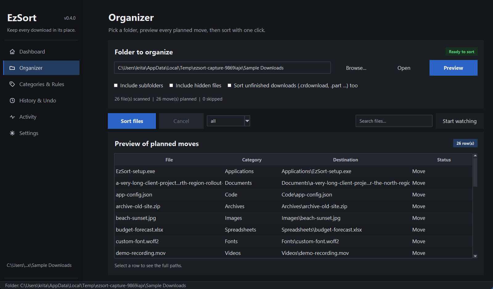
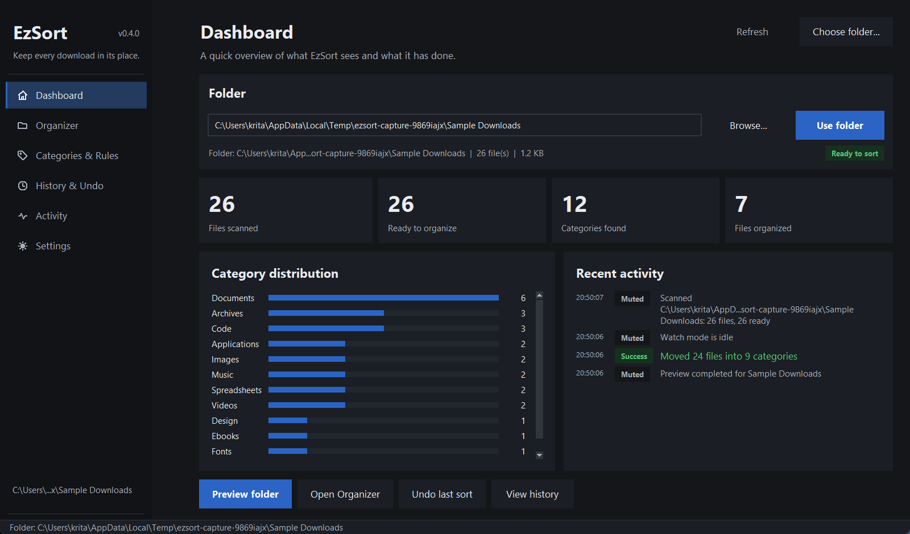
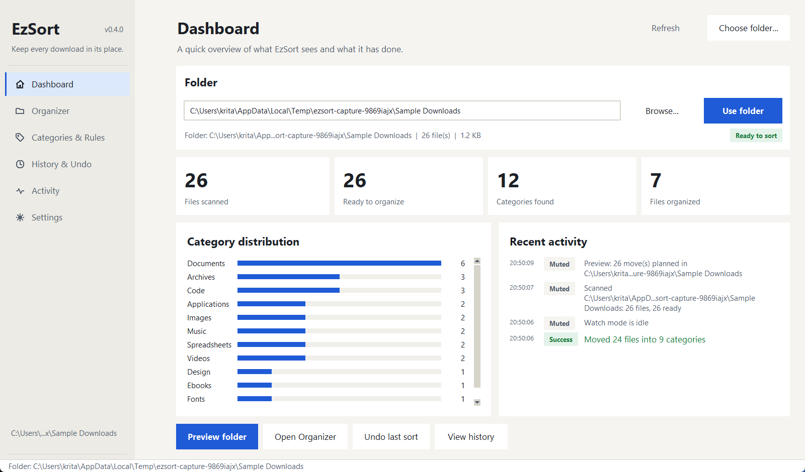
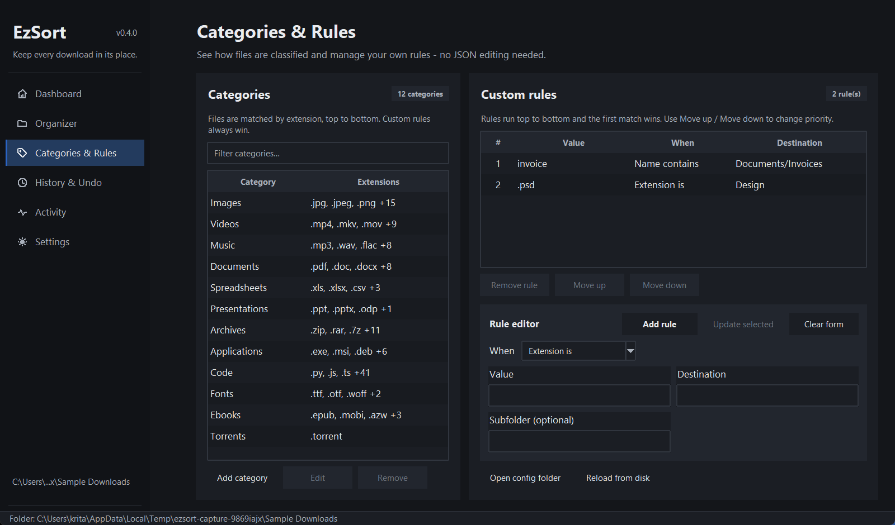
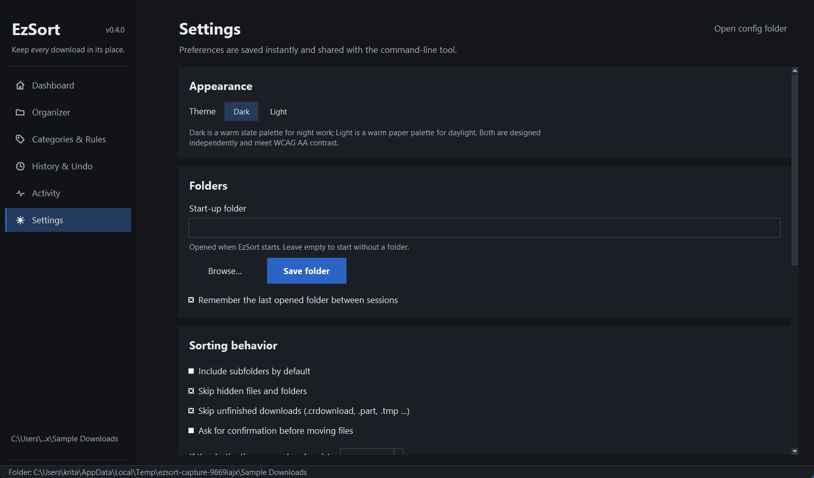
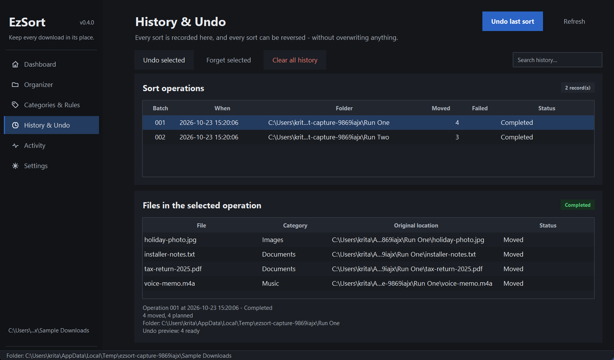
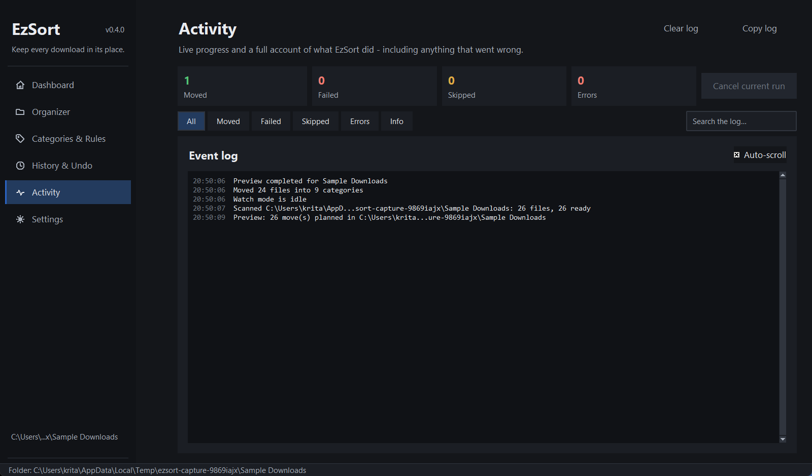

# EzSort

> Your downloads folder is a disaster. EzSort fixes that — from the command line or a polished desktop app.

---

## What does EzSort do?

It takes a messy folder and sorts every file into neat subfolders based on what kind of file it is.

**Before:**
```
Downloads/
  vacation.jpg
  gf.png
  resume.pdf
  tax-return.pdf
  concert.mp4
  playlist.mp3
  backup.zip
  setup.exe
  app.py
  budget.csv
  presentation.pptx
  .DS_Store
  MyProject/
```

**After `ezsort organize ~/Downloads`:**
```
Downloads/
  Images/
    vacation.jpg
    gf.png
  Documents/
    tax-return.pdf
    resume.pdf
  Videos/
    concert.mp4
  Music/
    playlist.mp3
  Archives/
    backup.zip
  Applications/
    setup.exe
  Code/
    app.py
  Spreadsheets/
    budget.csv
  Presentations/
    presentation.pptx
  MyProject/          <- untouched
```

No files deleted. No files overwritten. Just organized.

---

## Desktop App (v0.4.0)

EzSort ships with a premium desktop app — same engine, same safety
guarantees, zero extra runtime dependencies (it uses the Tkinter that
already comes with Python). Dark theme by default, with a full light
theme; both are contrast-checked to WCAG AA.















**Features**

- **Dashboard** — pick a folder, see live stats, jump straight into a preview
- **Organizer** — preview every planned move in a table, filter or search the plan, then execute with one click; cancellable mid-sort
- **Categories** — browse built-in categories and add/edit/delete custom rules, with validation before saving
- **History** — search past sorts, inspect the files in each, and undo any batch (conflict-safe)
- **Activity** — live, persisted event log of everything EzSort did, this session and last
- **Settings** — dark/light theme, duplicate strategy, watch interval, and more; changes save instantly

Every button does real work — previews are the same plan the CLI would
execute, and every number comes from the engine, config, history, or
activity log.

**Keyboard shortcuts**

| Key | Action |
|-----|--------|
| `Ctrl+1` … `Ctrl+6` | Jump to a page |
| `F5` | Refresh the current page |
| `Ctrl+F` | Focus the current page's search |
| `Ctrl+O` | Choose a folder |
| `F1` | Show the shortcut sheet |
| `Enter` | Run a preview from the folder box |
| `Esc` | Close an overlay / leave search |

**Launch it**

```bash
ezsort gui              # from the CLI
ezsort-gui              # dedicated launcher
python -m ezsort.gui    # as a module
```

Or download the standalone Windows `EzSort.exe` from
[Releases](https://github.com/kritagyadubey/EzSort/releases) — no Python
required.

---

## Install

```bash
pip install ezsort
```

That's it. Zero dependencies. Works on Windows, macOS, and Linux.

Windows users can also grab the standalone executables (GUI + CLI) from
the [Releases page](https://github.com/kritagyadubey/EzSort/releases).

---

## Quick Start

```bash
# Preview what would happen (nothing gets moved)
ezsort organize ~/Downloads --dry-run

# Actually sort the folder
ezsort organize ~/Downloads --yes

# Open the desktop app
ezsort gui

# Scan a folder to see what's in it
ezsort scan ~/Downloads

# Undo the last sort
ezsort undo
```

---

## Commands

### `organize` -- Sort a folder

```bash
ezsort organize ~/Downloads              # Interactive (asks before moving)
ezsort organize ~/Downloads --yes        # Skip confirmation
ezsort organize ~/Downloads --dry-run    # Preview only
ezsort organize ~/Downloads -r           # Include subfolders
```

### `scan` -- Look without touching

```bash
ezsort scan ~/Downloads
```

Shows file counts by category, potential duplicates, and how many files could be organized.

### `watch` -- Auto-sort new files

```bash
ezsort watch ~/Downloads
```

Keeps a folder sorted automatically. New files get moved as they appear. Press `Ctrl+C` to stop.

### `gui` -- Open the desktop app

```bash
ezsort gui
```

Launches the EzSort desktop app in your saved theme (dark by default, light
available). Same engine, same preview-first safety.

### `undo` -- Take it back

```bash
ezsort undo                # undo the most recent sort
ezsort undo --batch 003    # undo a specific batch (see 'ezsort history')
```

Reverses a sort operation. Every file goes back to where it was. If an
original location is now occupied by a different file, EzSort skips it
(never overwrites) and keeps it in history so you can resolve it later.

### `history` -- See what happened

```bash
ezsort history              # List of past operations
ezsort history --details    # Show individual files per operation
ezsort history --clear      # Wipe the history
```

### `stats` -- Your sorting numbers

```bash
ezsort stats
```

Shows total files organized and breakdown by category.

### `config` -- View settings

```bash
ezsort config
```

Shows categories, custom rules, excluded directories, and preferences.

### `--about` -- About EzSort

```bash
ezsort --about
```

Shows version, author, and GitHub repo info.

---

## Flags

| Flag | What it does |
|------|-------------|
| `--help` | Show help for any command |
| `--version` | Print version number |
| `--verbose`, `-v` | Show detailed logs |
| `--quiet`, `-q` | Suppress extra output |
| `--dry-run` | Preview without moving files |
| `--yes`, `-y` | Skip confirmation prompt |
| `--recursive`, `-r` | Include subdirectories |

---

## How it works

1. **Scan** -- EzSort walks through your folder and finds every file
2. **Classify** -- Each file gets matched to a category by its extension (140+ types supported)
3. **Plan** -- It builds a list of moves, skipping files that are already in the right place
4. **Execute** -- Files get moved into their category folders
5. **Record** -- Everything is logged so you can undo it later

---

## Safe by design

EzSort will never:

- Delete your files
- Overwrite existing files (duplicates get renamed: `report.pdf` -> `report (1).pdf`)
- Extract archives
- Move folders (only files)
- Upload anything
- Require internet access

It skips hidden files, symlinks, and its own working directories.

---

## Custom rules

Create a config file to add your own classification rules:

- **Windows:** `%APPDATA%\ezsort\config.json`
- **Linux:** `~/.config/ezsort/config.json`
- **macOS:** `~/Library/Application Support/ezsort/config.json`

(Handy shortcut: the app's **Settings** page has an *Open config file*
button that jumps straight to it.)

Example:

```json
{
  "custom_rules": [
    {
      "type": "extension",
      "pattern": ".psd",
      "category": "Design"
    },
    {
      "type": "filename_contains",
      "pattern": "invoice",
      "category": "Documents/Invoices"
    },
    {
      "type": "filename_contains",
      "pattern": "college",
      "category": "Education"
    }
  ]
}
```

Custom rules override the default categories. Priority goes top to bottom.

---

## Supported file types

EzSort recognizes **140+ file extensions** across 12 categories:

| Category | Examples |
|----------|----------|
| Images | `.jpg`, `.png`, `.gif`, `.webp`, `.heic`, `.raw`, `.psd` |
| Videos | `.mp4`, `.mkv`, `.mov`, `.avi`, `.webm` |
| Music | `.mp3`, `.wav`, `.flac`, `.m4a`, `.ogg` |
| Documents | `.pdf`, `.docx`, `.txt`, `.md`, `.rtf` |
| Spreadsheets | `.xlsx`, `.csv`, `.ods`, `.tsv` |
| Presentations | `.pptx`, `.key`, `.odp` |
| Archives | `.zip`, `.rar`, `.7z`, `.tar.gz`, `.dmg` |
| Applications | `.exe`, `.msi`, `.deb`, `.apk`, `.app` |
| Code | `.py`, `.js`, `.ts`, `.java`, `.cpp`, `.go`, `.rs`, `.html` |
| Fonts | `.ttf`, `.otf`, `.woff2` |
| Ebooks | `.epub`, `.mobi`, `.azw3` |
| Torrents | `.torrent` |

---

## Platform support

- Windows 10/11
- macOS 10.15+
- Linux (Ubuntu, Fedora, Debian, Arch, etc.)
- Requires Python 3.9+

> **Tip:** set the `EZSORT_HOME` environment variable to relocate EzSort's
> config and data directory (handy for portable installs or tests).

---

## Troubleshooting

**"command not found: ezsort"**

Make sure the package is installed:

```bash
pip install ezsort
```

Or run it as a Python module:

```bash
python -m ezsort organize ~/Downloads
```

**"Permission denied"**

Some system folders need elevated permissions. Try running with appropriate access for that specific folder.

**Files not being organized**

Add `--verbose` to see what's happening:

```bash
ezsort organize ~/Downloads --verbose
```

---

## Development

```bash
git clone https://github.com/kritagyadubey/EzSort.git
cd EzSort
python -m venv venv
source venv/bin/activate   # Windows: venv\Scripts\activate
pip install -e ".[dev]"
pytest
```

**Tests**

```bash
pytest                       # full suite
pytest tests/test_gui.py     # desktop-app tests (auto-skip if Tk is missing)
python scripts/gui_smoke.py  # drives the real GUI end to end + screenshots
```

The suite runs every test against a throwaway `EZSORT_HOME`, so nothing
can ever read or overwrite your real configuration or history.

**Building the Windows executables**

```bash
python scripts/make_icon.py                              # regenerate the icon
pyinstaller packaging/ezsort-gui.spec --noconfirm         # -> dist/EzSort/EzSort.exe
pyinstaller packaging/ezsort-cli.spec --noconfirm         # -> dist/ezsort-cli/ezsort.exe
```

The executables embed real Windows version metadata (Product name,
version and author) and the app icon, so Explorer's Properties dialog
and the taskbar show them correctly.

**Verifying the built executables**

```bash
python scripts/verify_cli_exe.py   # end-to-end CLI run on a temp folder
python scripts/verify_gui_exe.py   # launches the real EXE, screenshots it
```

Both scripts work only on disposable `%TEMP%` directories — never on your
own files — and exit non-zero if anything fails.

CI builds both executables automatically on every push to `main`, and
attaches them to a GitHub Release whenever a `v*` tag is pushed.

---

## Contributing

Contributions welcome. See [CONTRIBUTING.md](CONTRIBUTING.md) for guidelines.

---

## License

MIT License -- see [LICENSE](LICENSE) for details.

---

## Author

Built by **Kritagya Dubey**

- GitHub: [github.com/kritagyadubey/EzSort](https://github.com/kritagyadubey/EzSort)
- Issues: [github.com/kritagyadubey/EzSort/issues](https://github.com/kritagyadubey/EzSort/issues)

> Keep Your Files Sorted, Effortlessly.
